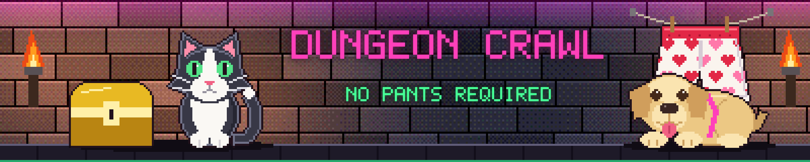

# Dungeon Crawl theme for Home Assistant

A loud, neon dungeon theme: torch-lit stone walls, dark cards, gold and magenta headings. All the art is original and drawn by script.



## Install

1. In HACS, add this repository as a custom repository of type **Theme**, then download it.
2. Call the `frontend.reload_themes` action.
3. Pick **Dungeon Crawl** on a view under its **Theme** setting, or in your profile.

The theme's background image loads from this repository, so it needs internet access.

## Pictures

`images/` also holds a banner, a cat, a pair of heart boxers and a gold chest for use in picture or markdown cards.

## Themes

- **Dungeon Crawl** is the original look, and the fallback if a theme is missing.
- **Dungeon Crawl Winter, Spring, Summer and Fall** each have their own wall, colours, cat outfit and box. `images/banner-winter-01.png` to `12` and the same for the other seasons carry a different season name each, so a dashboard can swap in a new banner every year.
- **Dungeon Crawl Halloween** swaps in green torches, cobwebs and pumpkin orange.
- **Christmas, New Year, Family Day, Easter, Victoria Day, Canada Day, BC Day, Labour Day, Thanksgiving, Truth and Reconciliation and Remembrance Day** each have their own wall, banner and colours.
- **Dungeon Crawl Birthday 01 to 20** are party looks. Their banners leave a dark panel for a dashboard to write a name on, and no names are stored here.

All of them set `dc-` colour variables and card pictures, including `dc-banner`, so card-mod styles that use them change with the theme. [Dungeon Season](https://github.com/goforth-device/ha-dungeon-season) switches between them by date.

`images/cat-mood-*.gif` are animated cat poses for showing what the house is up to.

`images/cat-mood-weather-*.gif` are one pose per Environment Canada weather hazard: `wind`, `rain`, `snow`, `cold`, `frost`, `ice` (freezing rain), `heat`, `fog`, `thunder`, `tornado` and `surge` (storm surge). Hazards that often arrive together have their own pose: `storm` (wind and rain), `blizzard` (wind and snow, or a winter storm), `outflow` (wind and cold, or Arctic outflow), `surge-storm` (storm surge with wind or rain) and `smoke` (heat and wildfire smoke). `cat-mood-weather.gif` is the general one for anything else, such as a special weather statement.

## Fonts

The theme asks for Bungee and Share Tech Mono and falls back to system fonts. To load them, add this as a dashboard resource of type **Stylesheet**:

```
https://fonts.googleapis.com/css2?family=Bungee&family=Share+Tech+Mono&display=swap
```
